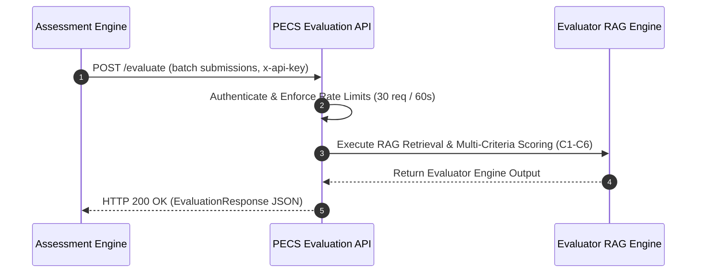

# Integration Handoff Guide: Assessment Engine Team

This guide provides complete technical instructions for integrating the **Assessment Engine** platform with the **PECS Evaluation API** (`POST /evaluate`).

---

## 1. System Integration Flow



1. The **Assessment Engine** collects student prompt submissions for an assignment (`task` and `student_prompt`).
2. The Assessment Engine posts a batch request to `POST /evaluate` containing authentication header `x-api-key`.
3. The API authenticates the caller, checks global rate limits, and validates request body schemas.
4. The evaluation engine processes the submissions, applies rubric weights, evaluates ethics gates, calculates overall narrative summaries and token costs, and returns a structured `EvaluationResponse`.

---

## 2. Request Contract & Headers

### HTTP Specification

- **Method**: `POST`
- **Path**: `/evaluate`
- **Content-Type**: `application/json`
- **Required Headers**:
  - `x-api-key` *(string, required)*: API key configured on the evaluation server.
  - `Content-Type: application/json`

### JSON Request Payload (`EvaluationRequest`)

```json
{
  "submissions": [
    {
      "task": "Write a Python function to compute the factorial of a number.",
      "student_prompt": "def factorial(n):\n    return 1 if n <= 1 else n * factorial(n - 1)",
      "domain": "CODE",
      "level": "strong"
    }
  ]
}
```

#### Field Specifications

| Field | Type | Required | Description |
|---|---|---|---|
| `submissions` | `Array<SubmissionRequest>` | **Yes** | Non-empty list of submissions to evaluate (`min_length=1`). |
| `task` | `string` | **Yes** | Non-empty task assignment description. |
| `student_prompt` | `string` | **Yes** | Non-empty student prompt submission text. |
| `domain` | `string` | No | Optional domain scope category (e.g. `"CODE"`). |
| `level` | `string` | No | Optional target skill level (e.g. `"strong"`, `"developing"`, `"weak"`). |

---

## 3. Success Response Format (`EvaluationResponse`)

Upon successful evaluation, the API returns **HTTP 200 OK**:

```json
{
  "evaluations": [
    {
      "submission_index": 1,
      "task": "Write a Python function to compute the factorial of a number.",
      "scores": {
        "c1": 9.0,
        "c2": 8.0,
        "c3": 8.0,
        "c4": 9.0,
        "c5": 10.0,
        "c6": 7.0
      },
      "composite_score": 8.55,
      "skill_level": "strong",
      "ethics_gate": {
        "mode": "weighted_only",
        "triggered": false,
        "c5_score": 10.0,
        "threshold": 3.0,
        "capped_score": null,
        "pre_gate_composite": 8.55,
        "policy_confirmation": "pending_alliance_compliance_confirmation"
      },
      "justifications": {
        "c1": "Clear task assignment scope.",
        "c2": "Correct mathematical algorithm logic.",
        "c3": "Sufficient context provided in prompt.",
        "c4": "Clean PEP-8 Python code formatting.",
        "c5": "Fully ethically compliant with no safety violations.",
        "c6": "Appropriate code complexity for task level."
      },
      "justification_truncated": [],
      "prompt_truncated": false,
      "calibration_used": true,
      "calibration_record_id": "rec-factorial-001",
      "domain": "CODE",
      "level": "strong",
      "confidence": null,
      "confidence_label": null,
      "confidence_status": "not_implemented_in_mvp",
      "model_version": "claude-haiku-4-5-20251001",
      "rubric_version": "pecs-rubric-v1.0",
      "rubric_tag": "pecs-rubric-v1.0+abcdef123456"
    }
  ],
  "overall_summary": {
    "strength": "Clean recursive implementation logic.",
    "weakness": "Lacks stack overflow handling for large input integers.",
    "improvement": "Consider providing an iterative loop alternative for very large inputs.",
    "source": "evaluator",
    "truncated": [],
    "criterion_averages": {
      "c1": 9.0,
      "c2": 8.0,
      "c3": 8.0,
      "c4": 9.0,
      "c5": 10.0,
      "c6": 7.0
    }
  },
  "usage": {
    "input_tokens": 1100,
    "output_tokens": 250,
    "cache_creation_input_tokens": 0,
    "cache_read_input_tokens": 0,
    "attempts": 1,
    "estimated_input_tokens": 850,
    "cost_usd": 0.00235
  },
  "rubric_version": "pecs-rubric-v1.0",
  "rubric_tag": "pecs-rubric-v1.0+abcdef123456",
  "model_version": "claude-haiku-4-5-20251001",
  "meta": {
    "submissions": 1,
    "calibrated_submissions": 1,
    "weights": {
      "c1": 0.15,
      "c2": 0.20,
      "c3": 0.20,
      "c4": 0.20,
      "c5": 0.15,
      "c6": 0.10
    },
    "config": {
      "PECS_EVALUATOR_MODEL": "claude-haiku-4-5-20251001"
    },
    "caching": {
      "requested": true,
      "prefix_tokens": 850,
      "expected_effective": false
    }
  }
}
```

---

## 4. Error Handling & Status Codes

| Status Code | Description | Engine Error Code | Assessment Engine Action |
|---|---|---|---|
| **HTTP 403** | Forbidden | Header Auth | Verify `x-api-key` header configuration. |
| **HTTP 413** | Content Too Large | `RAG_TOKEN_SAFETY_ABORT` | Reduce batch submission size or prompt length ($\le 4000$ tokens). |
| **HTTP 422** | Unprocessable Entity | `EVAL_INVALID_INPUT` | Fix request JSON body schema / missing required fields. |
| **HTTP 429** | Too Many Requests | `RAG_LLM_RATE_LIMITED` | Pause requests; respect 30 req / 60s global rate limit. |
| **HTTP 500** | Internal Error | `RAG_RETRIEVAL_FAILED` | Internal server or vectorstore issue. Contact platform team. |
| **HTTP 502** | Bad Gateway | `RAG_LLM_AUTH_ERROR` | Upstream LLM provider failure. |
| **HTTP 504** | Gateway Timeout | `RAG_LLM_TIMEOUT` | Upstream LLM call timed out. Eligible for automatic retry. |

---

## 5. Retry Guidance (`error.retryable`)

All API error responses include a `retryable` boolean field:

```json
{
  "error": {
    "code": "RAG_LLM_TIMEOUT",
    "layer": "rag",
    "message": "Anthropic LLM call timed out after 30 seconds",
    "details": { "timeout_seconds": 30 },
    "retryable": true
  }
}
```

- **When `retryable: true`**: The Assessment Engine may safely retry the request using **exponential backoff with jitter** (e.g. 1s, 2s, 4s).
- **When `retryable: false`**: Do **NOT** retry automatically. Fix the underlying payload error (e.g. split batch or trim prompts for 413 aborts, fix schema for 422 errors).

---

## 6. Rate-Limiting Policy

- **Global Sliding Window Limit**: **30 requests per 60 seconds** across all clients combined.
- **Exceeding Quota**: Rejects with **HTTP 429 Too Many Requests**.

---

## 7. Cross-References

- **Request Contract**: [`docs/integration_contract_request.md`](file:///c:/Users/nidhi%20chougule/Desktop/PECS-Evaluation-API-RAG-Platform-main/PECS-Evaluation-API-RAG-Platform-main/docs/integration_contract_request.md)
- **Response Contract**: [`docs/integration_contract_response.md`](file:///c:/Users/nidhi%20chougule/Desktop/PECS-Evaluation-API-RAG-Platform-main/PECS-Evaluation-API-RAG-Platform-main/docs/integration_contract_response.md)
- **Error Contract**: [`docs/integration_contract_errors.md`](file:///c:/Users/nidhi%20chougule/Desktop/PECS-Evaluation-API-RAG-Platform-main/PECS-Evaluation-API-RAG-Platform-main/docs/integration_contract_errors.md)
- **Payload Examples**: [`docs/integration_examples.md`](file:///c:/Users/nidhi%20chougule/Desktop/PECS-Evaluation-API-RAG-Platform-main/PECS-Evaluation-API-RAG-Platform-main/docs/integration_examples.md)
- **SLA & Policy**: [`docs/integration_sla.md`](file:///c:/Users/nidhi%20chougule/Desktop/PECS-Evaluation-API-RAG-Platform-main/PECS-Evaluation-API-RAG-Platform-main/docs/integration_sla.md)
