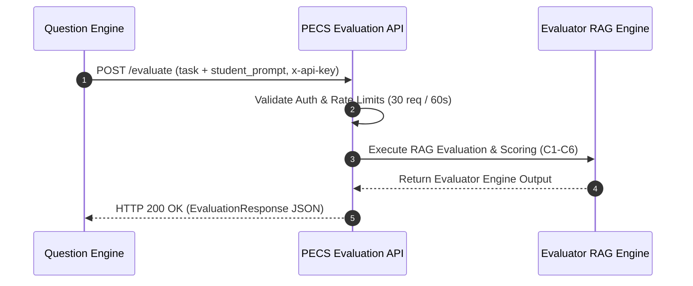

# Integration Handoff Guide: Question Engine Team

This guide provides complete technical instructions for integrating the **Question Engine** service with the **PECS Evaluation API** (`POST /evaluate`).

---

## 1. System Integration Flow



1. The **Question Engine** generates a task problem description (`task`) and candidate prompt text (`student_prompt`).
2. The Question Engine sends a `POST /evaluate` HTTP request with authentication header `x-api-key`.
3. The API validates request headers, enforces sliding-window rate limiting, and validates schema parameters.
4. The evaluation engine scores the prompt across criteria C1 through C6, evaluates ethics gates, generates feedback, and returns a structured `EvaluationResponse`.

---

## 2. Request Contract & Headers

### HTTP Specification

- **Method**: `POST`
- **Path**: `/evaluate`
- **Content-Type**: `application/json`
- **Required Headers**:
  - `x-api-key` *(string, required)*: Key credential configured on the API server.
  - `Content-Type: application/json`

### JSON Request Payload (`EvaluationRequest`)

```json
{
  "submissions": [
    {
      "task": "Write a Python function to check if a string is a palindrome.",
      "student_prompt": "def is_palindrome(s):\n    cleaned = \"\".join(c.lower() for c in s if c.isalnum())\n    return cleaned == cleaned[::-1]",
      "domain": "CODE",
      "level": "strong"
    }
  ]
}
```

#### Field Specifications

| Field | Type | Required | Description |
|---|---|---|---|
| `submissions` | `List` | **Yes** | Array of submission items to evaluate (`min_length=1`). |
| `task` | `string` | **Yes** | Non-empty problem prompt assigned to student. |
| `student_prompt` | `string` | **Yes** | Non-empty candidate prompt text to evaluate. |
| `domain` | `string` | No | Domain category (e.g. `"CODE"`) to scope calibration retrieval. |
| `level` | `string` | No | Target skill level (e.g. `"strong"`, `"developing"`, `"weak"`). |

---

## 3. Success Response Format (`EvaluationResponse`)

Upon successful evaluation, the API returns **HTTP 200 OK**:

```json
{
  "evaluations": [
    {
      "submission_index": 1,
      "task": "Write a Python function to check if a string is a palindrome.",
      "scores": {
        "c1": 9.5,
        "c2": 9.0,
        "c3": 8.5,
        "c4": 9.0,
        "c5": 10.0,
        "c6": 8.0
      },
      "composite_score": 9.0,
      "skill_level": "strong",
      "ethics_gate": {
        "mode": "weighted_only",
        "triggered": false,
        "c5_score": 10.0,
        "threshold": 3.0,
        "capped_score": null,
        "pre_gate_composite": 9.0,
        "policy_confirmation": "pending_alliance_compliance_confirmation"
      },
      "justifications": {
        "c1": "Prompt specifies exact task requirements clearly.",
        "c2": "Logical string cleaning and slicing comparison algorithm.",
        "c3": "Sufficient context provided for execution.",
        "c4": "Clean Python syntax following PEP-8 rules.",
        "c5": "No ethical, bias, or safety violations detected.",
        "c6": "Appropriate code complexity for skill level."
      },
      "justification_truncated": [],
      "prompt_truncated": false,
      "calibration_used": true,
      "calibration_record_id": "rec-palindrome-001",
      "domain": "CODE",
      "level": "strong",
      "confidence": null,
      "confidence_label": null,
      "confidence_status": "not_implemented_in_mvp",
      "model_version": "claude-haiku-4-5-20251001",
      "rubric_version": "pecs-rubric-v1.0",
      "rubric_tag": "pecs-rubric-v1.0+abcdef123456"
    }
  ],
  "overall_summary": {
    "strength": "Clean alphanumeric filtering and concise string slicing comparison.",
    "weakness": "Does not handle extremely large input strings efficiently in memory.",
    "improvement": "Consider two-pointer approach to check palindrome in O(1) extra space.",
    "source": "evaluator",
    "truncated": [],
    "criterion_averages": {
      "c1": 9.5,
      "c2": 9.0,
      "c3": 8.5,
      "c4": 9.0,
      "c5": 10.0,
      "c6": 8.0
    }
  },
  "usage": {
    "input_tokens": 1050,
    "output_tokens": 230,
    "cache_creation_input_tokens": 0,
    "cache_read_input_tokens": 0,
    "attempts": 1,
    "estimated_input_tokens": 800,
    "cost_usd": 0.00215
  },
  "rubric_version": "pecs-rubric-v1.0",
  "rubric_tag": "pecs-rubric-v1.0+abcdef123456",
  "model_version": "claude-haiku-4-5-20251001",
  "meta": {
    "submissions": 1,
    "calibrated_submissions": 1,
    "weights": {
      "c1": 0.15,
      "c2": 0.20,
      "c3": 0.20,
      "c4": 0.20,
      "c5": 0.15,
      "c6": 0.10
    },
    "config": {
      "PECS_EVALUATOR_MODEL": "claude-haiku-4-5-20251001"
    },
    "caching": {
      "requested": true,
      "prefix_tokens": 800,
      "expected_effective": false
    }
  }
}
```

---

## 4. Error Handling & Status Codes

| Status Code | Description | Engine Error Code | Action for Question Engine |
|---|---|---|---|
| **HTTP 403** | Forbidden | Header Auth | Check server `x-api-key` header configuration. |
| **HTTP 413** | Content Too Large | `RAG_TOKEN_SAFETY_ABORT` | Reduce prompt text length ($\le 4000$ tokens). |
| **HTTP 422** | Unprocessable Entity | `EVAL_INVALID_INPUT` | Fix request body JSON formatting / missing fields. |
| **HTTP 429** | Too Many Requests | `RAG_LLM_RATE_LIMITED` | Pause requests; respect 30 req / 60s rate limit. |
| **HTTP 500** | Internal Error | `RAG_RETRIEVAL_FAILED` | Internal server or vectorstore issue. Contact platform team. |
| **HTTP 502** | Bad Gateway | `RAG_LLM_AUTH_ERROR` | Upstream LLM provider failure. |
| **HTTP 504** | Gateway Timeout | `RAG_LLM_TIMEOUT` | LLM call timed out. Eligible for automatic retry. |

---

## 5. Retry Guidance (`error.retryable`)

All API pipeline error responses return a `retryable` boolean field:

```json
{
  "error": {
    "code": "RAG_LLM_TIMEOUT",
    "layer": "rag",
    "message": "Anthropic LLM call timed out after 30 seconds",
    "details": { "timeout_seconds": 30 },
    "retryable": true
  }
}
```

- **When `retryable: true`**: The Question Engine may safely retry the request using **exponential backoff with jitter** (e.g. 1s, 2s, 4s).
- **When `retryable: false`**: Do **NOT** retry automatically. Fix the underlying payload error (e.g. reduce input size for 413 aborts, fix JSON schemas for 422 errors).

---

## 6. Rate-Limiting Policy

- **Global Sliding Window Limit**: **30 requests per 60 seconds** across all clients combined.
- **Exceeding Quota**: Rejects with **HTTP 429 Too Many Requests**.

---

## 7. Cross-References

- **Request Contract**: [`docs/integration_contract_request.md`](file:///c:/Users/nidhi%20chougule/Desktop/PECS-Evaluation-API-RAG-Platform-main/PECS-Evaluation-API-RAG-Platform-main/docs/integration_contract_request.md)
- **Response Contract**: [`docs/integration_contract_response.md`](file:///c:/Users/nidhi%20chougule/Desktop/PECS-Evaluation-API-RAG-Platform-main/PECS-Evaluation-API-RAG-Platform-main/docs/integration_contract_response.md)
- **Error Contract**: [`docs/integration_contract_errors.md`](file:///c:/Users/nidhi%20chougule/Desktop/PECS-Evaluation-API-RAG-Platform-main/PECS-Evaluation-API-RAG-Platform-main/docs/integration_contract_errors.md)
- **Payload Examples**: [`docs/integration_examples.md`](file:///c:/Users/nidhi%20chougule/Desktop/PECS-Evaluation-API-RAG-Platform-main/PECS-Evaluation-API-RAG-Platform-main/docs/integration_examples.md)
- **SLA & Policy**: [`docs/integration_sla.md`](file:///c:/Users/nidhi%20chougule/Desktop/PECS-Evaluation-API-RAG-Platform-main/PECS-Evaluation-API-RAG-Platform-main/docs/integration_sla.md)
